# AI Systems Atlas

An educational, end-to-end Retrieval-Augmented Generation (RAG) application,
plus an interactive guide to the architecture behind it. The project demonstrates
document ingestion, vector search, reranking, guardrails, model routing, and
observability; it is a learning/reference project, not a production security
boundary.

## What’s included

- **Document ingestion:** parses PDF, HTML, TXT, DOCX, and PPTX files; splits text
  into paragraph-based chunks; embeds them; and indexes vectors and metadata in
  Qdrant.
- **Retrieval and answers:** embeds a question, searches Qdrant, reranks up to 15
  candidates locally with FlashRank, then uses a Groq chat model to answer from
  the retrieved context.
- **Conversation planning:** LangGraph routes conversational messages directly
  to the responder and technical questions through retrieval.
- **Guardrails:** NeMo Guardrails applies the configured topic/dialog flows
  before the LangGraph workflow.
- **Model routing:** calls Groq directly when `PORTKEY_API_KEY` is absent. If
  Portkey is configured, the application uses its gateway and expects the
  `rag`/`brag` virtual-key aliases to be configured there.
- **Observability:** Pydantic Logfire records application traces when configured.
  LangSmith tracing is disabled when its API key is absent.
- **Evaluation:** an optional RAGAS evaluation application and related materials
  are in `evals/` and `DOCS/`.
- **Interactive architecture guide:** a separate Streamlit app explains
  ingestion, guardrails, and gateways with diagrams and learning demos.

## Architecture

```mermaid
flowchart LR
    Files[PDF / HTML / TXT / DOCX / PPTX] --> Parse[Parse and clean]
    Parse --> Chunk[Paragraph chunking]
    Chunk --> Embed[Gemini embeddings]
    Embed -. initial Gemini probe fails .-> Local[Local all-mpnet-base-v2 fallback]
    Embed --> Qdrant[(Qdrant vector collection)]
    Local --> Qdrant

    User[User] --> UI[Streamlit chat UI]
    UI --> API[FastAPI /query]
    API --> Guard[NeMo Guardrails]
    Guard --> Planner[LangGraph planner]
    Planner -->|Conversational| LLM[Groq / optional Portkey]
    Planner -->|Technical| QueryEmbed[Query embedding]
    QueryEmbed --> Qdrant
    Qdrant --> Candidates[Up to 15 candidates]
    Candidates --> Rank[Local FlashRank reranker]
    Rank --> LLM
    LLM --> UI
    API -. traces .-> Logfire[Pydantic Logfire]
```



## Project layout

```text
app/
  agents/                  LangGraph planner, retrieval, and responder
  gateway/                 Portkey gateway and direct-Groq client selection
  guardrails/              NeMo Guardrails configuration and policy flows
  ingestion/
    chunking/              Paragraph-based text splitter
    loaders/               PDF, HTML, TXT, DOCX, and PPTX parsers
  services/retrieval/      Embedding, Qdrant search, and reranking services
  config.py                Environment-variable settings
  main.py                  FastAPI application
ai_architecture_guide/
  streamlit_app.py         Standalone interactive learning guide
  README.md                Guide-specific launch instructions
ui/                        Streamlit chat interface
evals/                      RAGAS evaluation app and pipeline
DATA/
  true_data/                Example trusted/reference documents
  noisy_data/               Example noisy documents
processed_data/             Generated parsed/chunked JSON; do not commit outputs
DOCS/                       System, ingestion, guardrails, gateway, and eval docs
requirements.txt
```

The sample `DATA/` corpus and generated `processed_data/` are intentionally
excluded from version control. Some source documents may be third-party
copyrighted material; provide your own appropriately licensed data when running
the ingestion examples.

## Requirements

- Python 3.11 (the project has been run with Python 3.11)
- Qdrant Cloud or a reachable Qdrant server
- A Groq API key for chat generation and guardrails
- A Gemini API key for hosted embeddings, unless using the local embedding
  fallback
- Optional: a Portkey API key and configured `rag`/`brag` virtual-key aliases
- Optional: a Logfire project write token or API key with **Send telemetry**
  permission
- Optional: a valid LangSmith API key if you explicitly enable LangSmith tracing

## Setup

Run commands from the repository root.

### Linux, macOS, or EC2

```bash
python3.11 -m venv .venv
source .venv/bin/activate
python -m pip install --upgrade pip
pip install -r requirements.txt
```

### Windows PowerShell

```powershell
py -3.11 -m venv .venv
.\.venv\Scripts\Activate.ps1
python -m pip install --upgrade pip
pip install -r requirements.txt
```

## Environment configuration

Copy `.env.sample` to `.env` in the repository root, then replace the `xxx`
placeholders with your own values. Never commit `.env`, paste credentials into
issues, or include real keys in screenshots or logs.

```bash
cp .env.sample .env
# Edit .env and replace the placeholders before starting the application.
```

`QDRANT_CLUSTER_ENDPOINT` is also accepted as an alternative to `QDRANT_URL`.
The default Qdrant collection name is `enterprise_rag`.

## Ingest documents

From the repository root:

```bash
python -m app.ingestion.processor DATA
```

When `DATA` contains `true_data/` and `noisy_data/` subdirectories, the
processor labels those sources `true` and `noisy` automatically. To ingest just
one directory, pass its label explicitly:

```bash
python -m app.ingestion.processor DATA/true_data true
python -m app.ingestion.processor DATA/noisy_data noisy
```

The pipeline writes parsed chunks to `processed_data/` and uploads their
embeddings and metadata to Qdrant. Check the output for `Indexed ... points`
and `Failed to process ...` messages: **`Ingestion job completed` means the
scan ended, not that every file succeeded.**

### Important ingestion notes

- `--wipe` **deletes the configured Qdrant collection before recreating it**.
  Only use it when you intend to remove all indexed points in that collection.
- Re-running a directory without wiping can create duplicate points because
  ingestion assigns new random point IDs to every chunk.
- Gemini embeddings have 3,072 dimensions; the local `all-mpnet-base-v2`
  fallback has 768. A Qdrant collection must use the same vector size as the
  embedding model used for both indexing and queries. Switching models requires
  a matching collection and re-embedding the documents.
- The fallback is selected when the **initial Gemini probe** fails. If Gemini
  becomes rate-limited later during a run, the current code retries and may log
  that file as failed; it does not switch that file to local embeddings.
- A failed file’s parsed JSON may still exist in `processed_data/`, even though
  its vectors were not indexed.

## Run the applications

### FastAPI backend

```bash
uvicorn app.main:app --host 127.0.0.1 --port 8000 --reload
```

Open `http://127.0.0.1:8000/` for the health response and
`http://127.0.0.1:8000/docs` for the interactive API documentation.

### Streamlit chat UI

In another terminal:

```bash
streamlit run ui/app.py --server.address 127.0.0.1 --server.port 8501
```

The chat UI sends requests to `BACKEND_URL`, defaulting to
`http://localhost:8000`. Configure `BACKEND_URL` if the backend is at another
reachable address.

### Interactive AI architecture guide

Run the guide separately from the chat UI:

```bash
streamlit run ai_architecture_guide/streamlit_app.py \
  --server.address 127.0.0.1 --server.port 8502
```

The guide covers ingestion and vector search, guardrails, and model gateways.
Its diagrams and playgrounds are educational simulations; they do not call
production services.

### Access EC2 apps through SSH tunnels

Keep the backend and Streamlit apps bound to `127.0.0.1` on EC2. On your local
computer, open an SSH tunnel (replace the key path and public IP):

```bash
ssh -i /path/to/key.pem \
  -N \
  -L 8000:127.0.0.1:8000 \
  -L 8501:127.0.0.1:8501 \
  -L 8502:127.0.0.1:8502 \
  ubuntu@EC2_PUBLIC_IP
```

Keep the SSH session open, then visit:

- Chat UI: `http://localhost:8501`
- Architecture guide: `http://localhost:8502`
- API docs: `http://localhost:8000/docs`

SSH tunneling avoids exposing these development ports to the public internet.

## Verify a run

- **API health:** `curl http://127.0.0.1:8000/`
- **Chat:** submit a question from the UI or use `http://127.0.0.1:8000/docs`.
- **Ingestion:** check terminal output for indexed and failed files; an
  `Ingestion job completed` line by itself does not prove complete ingestion.
- **Logfire:** open the configured project's Live view and select a time range
  that includes the request. The app must have a valid telemetry credential
  with permission to send telemetry.
- **Qdrant:** check the `enterprise_rag` collection's point count in Qdrant
  Cloud or query it with the Qdrant client. The count is total collection
  contents, not a count for only the latest ingestion run.

## Costs and service choices

This project combines self-hostable/open-source components with hosted APIs.
For example, Qdrant can be self-hosted or managed; FlashRank and the local
sentence-transformer run on your machine; Gemini and Groq are hosted APIs.
Portkey, Logfire, and LangSmith are optional services in this setup. “Free”
tiers, model availability, rate limits, prices, and licensing can change; check
the providers' current terms and the costs of EC2, storage, and API usage.

## Documentation

| Guide | Description |
|---|---|
| [System overview](DOCS/01_SYSTEM_OVERVIEW.md) | End-to-end architecture |
| [Ingestion engine](DOCS/02_INGESTION_ENGINE.md) | Parsing and indexing |
| [Node intelligence](DOCS/03_NODE_INTELLIGENCE.md) | Planner, retriever, and responder |
| [Tracing and observability](DOCS/04_TRACING_AND_OBSERVABILITY.md) | Logfire and LangSmith |
| [Environment variables](DOCS/05_ENVIRONMENT_VARIABLES.md) | Configuration reference |
| [Known gotchas](DOCS/06_KNOWN_GOTCHAS.md) | Operational caveats |
| [FlashRank reranking](DOCS/07_FLASHRANK_RERANKING.md) | Reranking details |
| [Guardrails](DOCS/08_GUARDRAILS.md) | NeMo Guardrails |
| [LLM gateway](DOCS/09_LLM_GATEWAY.md) | Portkey and model routing |
| [Evals](DOCS/10_EVALS.md) | Evaluation concepts |
| [Evals pipeline](DOCS/11_EVALS_PIPELINE.md) | Evaluation runner and UI |

## Security reminder

Do not commit `.env`, API keys, Logfire tokens, private source documents, or
generated processed data. If a credential is accidentally exposed, revoke it
with its provider and replace it in the local secret store.
